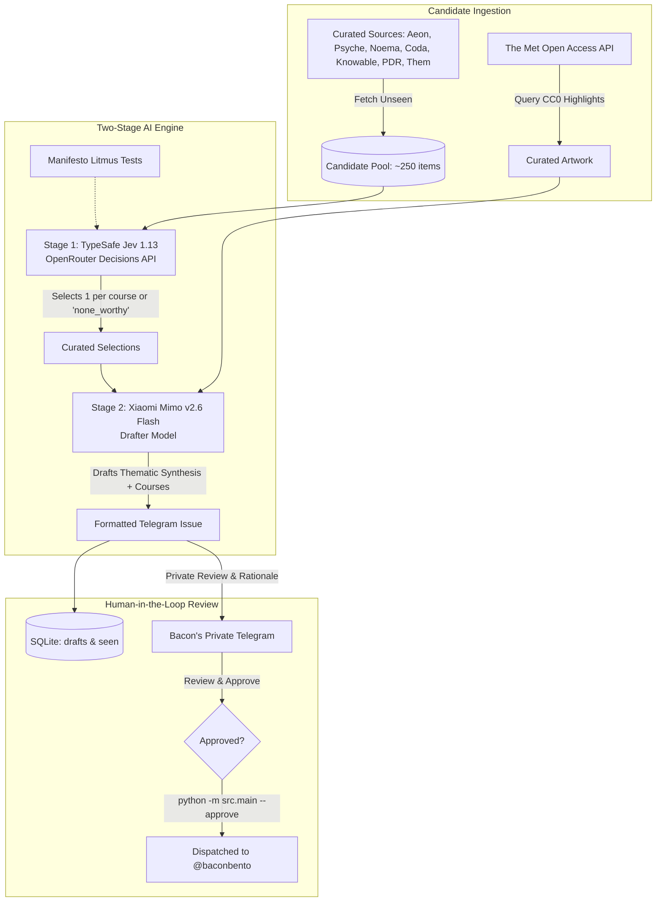

# 🍱 Bacon's Bento: System Architecture & Editorial Engine

> *"A digital garden of curious intersections, slow ideas, and quiet craft."*

**Bacon's Bento** (`@baconbento`) is an intentional, AI-assisted curatorial engine and personal digital garden. It transforms an open ocean of weekly readings and archival art into an *omakase* tasting menu dispatched to Telegram.

This document serves as the complete technical, conceptual, and operational reference for your Obsidian vault.

---

## 1. The Core Philosophy

Unlike typical RSS firehoses, Bacon's Bento rejects algorithm-driven consensus and breaking-news hysteria. Every dispatch is guided by the **Bento Manifesto**:

### The 4 Pillars of Taste
1. 🧩 **Interdisciplinary Collision:** Domain A illuminating Domain B through metaphorical cross-pollination.
2. 🪐 **The Foreign & The Strange (Cognitive Estrangement):** Deliberate detours into the unfamiliar, the archival, and the obscure.
3. 🪵 **Slow Craft & Tangible Care:** Honoring human labor, patient inquiry, and devotion to form over churned summary.
4. 🌅 **Grounded Optimism:** Expanding the reader's sense of possibility, moral imagination, and material problem-solving.

### The Anti-Pillars (What We Explicitly Reject)
- 🚫 **The 24-Hour News Cycle:** Breaking news, market ticks, horse races.
- 🚫 **Predictable Consensus:** Op-eds that reach the exact conclusion anticipated by the headline.
- 🚫 **Cynicism as a Substitute for Rigor:** Critiques that tear down without building alternative understanding.
- 🚫 **Single-Dimension Optimization:** Productivity tropes, listicles, lifehacks.
- 🚫 **Paywall Bait-and-Switch:** Dispatches that trap readers behind surprise subscription walls.

> [!important] The Curatorial Code of Honor
> **Silence Beats Noise:** A silent channel is better than a noisy one. If no candidate in a course meets the standard on a given week, that slot remains empty. We never pad the plate.

---

## 2. The 5-Course Bento Plate

A real bento is never a homogenous pile; it is an artful arrangement of distinct, complementary flavors:

| Course | Name | Focus | Sources |
| :--- | :--- | :--- | :--- |
| **1. ⚓** | **The Anchor** | Philosophy, ethics, deep time, interiority | *Aeon, Psyche, Noema* |
| **2. 👁** | **The Lens** | Thematic, non-cyclical narrative investigation | *Coda Story, r/longform* |
| **3. 🩺** | **The Craft** | Empirical science & mental models translated | *Knowable Magazine, Big Think* |
| **4. 🃏** | **The Garnish** | Historical oddities, archival artifacts, subcultures | *The Public Domain Review, Them (Culture)* |
| **5. 🌳** | **Visual Garnish** | High-res CC0 public-domain art & antiquities | *The Metropolitan Museum of Art Open Access* |

---

## 3. High-Level System Architecture



---

## 4. The Two-Stage AI Engine

### Stage 1: The Decision Model (`typesafe/jev-1.13`)
- **Endpoint:** `https://openrouter.ai/api/alpha/decisions`
- **Role:** Evaluates ~250 candidates across the 4 reading courses against the Bento Manifesto.
- **Why Jev:** Jev is a specialized decision model that computes exact probability weights, confidence, and categorical choices in **~1.0 second** at virtually zero cost (~$0.00001/call).
- **Enforcement Rules:**
  - Evaluates candidate pool by course.
  - Can select `"none_worthy"` if no article clears the taste bar.
  - Strictly prevents source collisions (at most 1 article from any single source per issue).

### Stage 2: The Drafter Model (`xiaomi/mimo-v2.6-flash`)
- **Endpoint:** `https://openrouter.ai/api/v1/chat/completions`
- **Role:** Acts as the master essayist and editorial voice.
- **The Signature Feature:** Writes the **Thematic Synthesis Intro**—a 2–4 sentence opening that weaves together the subtle nuances, common threads, and conceptual undercurrent connecting the disparate pieces.
- **Formatting Guarantees:** Validates against Telegram HTML limitations and character caps (< 2,400 chars).

---

## 5. Course 5: The Met Open Access Integration

The Visual Ambient Garnish connects directly to **The Metropolitan Museum of Art Open Access Collection**:

- **Target Departments:** Asian Art, European Paintings, Drawings & Prints, Medieval Art, Modern Art, etc.
- **Criteria:** High-resolution image available + `isPublicDomain: true` (CC0).
- **Deduplication:** Object IDs are tracked in SQLite (`seen_met` table) to prevent repeats.
- **Standardized Copy Specification:**
  ```html
  🌳 <b>Visual Garnish</b>
  <i><a href="[Met URL]">[Artwork Name] ([Year])</a></i>
  <i>[Artist] · [Medium] · [Department], The Met Collection (CC0)</i>
  [1 atmospheric observation linking light, craft, or form.]
  ```

---

## 6. The Human-in-the-Loop Review Protocol

Bacon's Bento is an *omakase* of personal taste, which means automated bots never publish directly to the public channel without human curation.

```
[Weekly Cron / Manual Trigger]
            │
            ▼
    python -m src.main --draft
            │
            ▼
   ┌────────────────────────────────────────────────────────┐
   │ 1. Ingests unseen RSS feeds + Met artwork              │
   │ 2. Jev 1.13 selects candidates with rationales         │
   │ 3. Mimo Flash drafts thematic intro + copy             │
   │ 4. Saves payload in SQLite drafts table                │
   │ 5. Dispatches 2 private messages to your Telegram:     │
   │    • Behind-the-scenes curatorial decision rationales  │
   │    • Full formatted Telegram issue preview + photo     │
   └────────────────────────────────────────────────────────┘
            │
            ▼
   [Review on Telegram] ────► Satisfied?
                                  │
                                 YES
                                  │
                                  ▼
                     python -m src.main --approve
                                  │
                                  ▼
                   Published live to @baconbento!
```

---

## 7. Command Reference (CLI Manual)

All commands are run from the project root (`/Users/pigarmahdargmail.com/Developer/Bacons-Bento`):

```bash
# 1. Activate Virtual Environment
source .venv/bin/activate

# 2. Run Test Suite (23 unit tests)
pytest -q

# 3. Check Live Feed Health (read-only audit)
python -m scripts.check_feeds

# 4. Analyze Publishing Frequency Across Feeds
python -m scripts.feed_cadence --days 90

# 5. Full Simulation (Dry Run — outputs to terminal, sends nothing)
python -m src.main --dry-run

# 6. Generate Weekly Draft & Send Private Review to Telegram
python -m src.main --draft

# 7. Approve & Publish the Latest Pending Draft to @baconbento
python -m src.main --approve

# 8. Approve a Specific Draft by Issue ID
python -m src.main --approve 1

# 9. Bootstrap Mode (record current backlog as seen without publishing)
python -m src.main --bootstrap
```

---

## 8. Directory & File Structure

```text
Bacons-Bento/
├── MANIFESTO.md                 # Core editorial principles & litmus tests
├── README.md                    # Quickstart guide
├── requirements.txt             # Python dependencies
├── .env                         # Private tokens (ignored by git)
│
├── config/
│   └── registry.yaml            # Single source of truth for sources & courses
│
├── data/
│   └── bento_history.db         # SQLite database (seen, seen_met, drafts)
│
├── docs/
│   └── EDITORIAL_GUIDE.md       # Standardized prompt & formatting specification
│
├── scripts/
│   ├── check_feeds.py           # Feed health auditor
│   └── feed_cadence.py          # 90-day publishing frequency analyzer
│
├── src/
│   ├── config.py                # Settings and registry loader
│   ├── curator.py               # TypeSafe Jev 1.13 decision engine
│   ├── drafter.py               # Xiaomi Mimo Flash sentence package drafter
│   ├── db.py                    # SQLite persistence (seen, seen_met, drafts)
│   ├── formatter.py             # Telegram HTML sanitizer & tag balancer
│   ├── llm.py                   # OpenRouter client (chat + alpha decisions)
│   ├── met.py                   # The Met Open Access API client
│   ├── parser.py                # RSS parser & entry sanitization
│   ├── telegram.py              # Telegram Bot API client (text + photos)
│   └── main.py                  # CLI orchestration pipeline
│
└── tests/
    ├── test_config.py
    ├── test_curator_drafter_met.py
    ├── test_db.py
    ├── test_formatter.py
    ├── test_parser.py
    └── test_telegram.py
```

---

## 9. Key Environment Variables (`.env`)

```ini
# Telegram Bot Configuration
TELEGRAM_BOT_TOKEN=your_bot_token_from_botfather
TELEGRAM_CHAT_ID=@baconbento
TELEGRAM_ADMIN_CHAT_ID=your_personal_telegram_numeric_id

# OpenRouter AI Configuration
OPENROUTER_API_KEY=sk-or-v1-xxxxxxxxxxxxxxxxxxxx
OPENROUTER_DECISION_MODEL=typesafe/jev-1.13
OPENROUTER_DRAFTING_MODEL=xiaomi/mimo-v2.6-flash

# Persistence
DB_PATH=data/bento_history.db
MAX_POSTS_PER_RUN=5
```

---

*Document compiled on 2026-10-14 for Bacon's Bento digital garden.*
